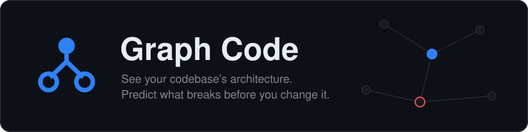
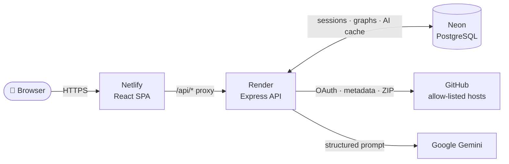
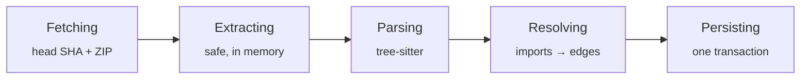
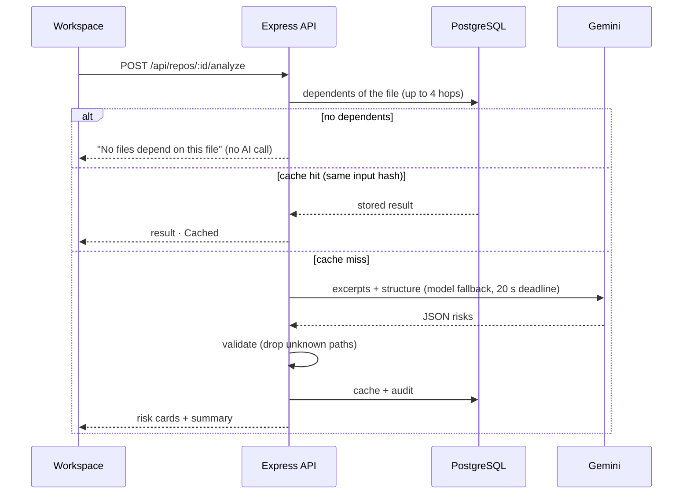

<div align="center">



<br />

**Turn any public GitHub repository into an interactive dependency graph, then ask AI what a change to one file will break.**

<br />

<a href="https://graph-code.netlify.app"></a>


<br /><br />


<br />


<br />


<br /><br />

[Features](#-features) · [How it works](#-how-it-works) · [Tech stack](#-tech-stack) · [Getting started](#-getting-started) · [Project status](#-project-status) · [Roadmap](#-roadmap-spring-2027)

</div>

---

## 🧭 What is Graph Code?

Opening an unfamiliar codebase is slow, and changing it is risky. Which files import this one? What else breaks if I edit it?

**Graph Code** answers both questions visually:

1. **Sign in with GitHub** and pick one of your public repositories, or paste any public `owner/name` or GitHub link.
2. Graph Code **downloads, parses and resolves every import** in the background, with live progress. The code is never executed.
3. You **explore the repository as a graph**: folders collapse into containers, edges are bundled with counts, and a click focuses on one file's neighbourhood.
4. Click **Analyze change impact (AI)** on a file. Gemini predicts which dependent files are at **High**, **Medium** or **Low** risk, explains why, and the graph lights up the blast radius.

> Graph Code is a year-long **Senior Project at Prince Mohammad Bin Fahd University**. This repository holds **Demo 1**, the first three increments of the real system, built on the lessons of a Summer 2026 prototype.

---

## ✨ Features

<table>
<tr>
<td width="50%" valign="top">

### 🔐 Secure GitHub sign-in
- OAuth with a `state` check and a server-side session stored in PostgreSQL
- The GitHub token is **encrypted at rest** and never sent to the browser
- `HttpOnly`, `Secure`, `SameSite=Lax` session cookie
- Logout destroys the session

</td>
<td width="50%" valign="top">

### 📥 Background ingestion
- Your public repositories, or any public repository by `owner/name` or URL
- Background job pinned to one commit SHA, with phase labels and a live progress bar
- In-memory ZIP extraction with safety limits: size, entry count, compression ratio and `..` paths
- Native **tree-sitter** parsing of JS, JSX, TS, TSX, MJS and CJS, plus `tsconfig` path resolution
- The whole graph is saved in **one atomic transaction**

</td>
</tr>
<tr>
<td valign="top">

### 🗺️ Interactive graph workspace
- Folders start collapsed. Wrapper folders such as `src/` open in place
- Edges are **bundled with counts** at rest. Exact file edges appear on hover
- **Focus mode** keeps a file's 1–2 hop neighbourhood bright and dims the rest
- File **search**, a synced **directory sidebar** and a minimap
- A **code drawer** with syntax highlighting, loaded on demand from GitHub
- Keyboard navigation throughout

</td>
<td valign="top">

### 🤖 AI change impact
- An explicit click only, after a one-time data notice
- Risk cards (**High** / **Medium** / **Low**) with reasons, and the blast radius drawn on the graph
- **Cached** by input hash: a repeat analysis returns in under 2 s
- Model fallback (`gemini-2.5-flash-lite` → `gemini-2.5-flash`) within a 20 s deadline
- Invented file paths are removed, and every outcome is audited
- Clear, distinct states for quota, timeout, network failure, malformed output and "no dependents"

</td>
</tr>
<tr>
<td valign="top">

### 📊 Dashboard
- Repository cards with status, file and dependency counts, languages and sync time
- Filter, retry a failed analysis, and delete with confirmation
- Distinct empty, loading and error states

</td>
<td valign="top">

### 🛡️ Built safe by default
- Parameterized SQL only. Every query is scoped to the signed-in user, and anyone else's data returns `404`
- GitHub requests go only to an **allow-list** of hosts
- Repository code is **parsed, never executed, never stored**
- Rate limits: 10 analyses per minute, one in flight per user
- `helmet` security headers. No `dangerouslySetInnerHTML`

</td>
</tr>
</table>

---

## ⚙️ How it works



The browser only ever calls `/api/*` on its own origin. Netlify proxies those calls to Render, so the session cookie stays first-party.

### Ingestion pipeline



The parser, extractor and resolver are **separate layers behind a language registry**, so new languages (Python and Java are planned) plug in without touching the pipeline.

### Change-impact analysis



---

## 🧰 Tech stack

| Layer | Technology |
|---|---|
| **Client** | React 19, Vite, React Router, Zustand, Bootstrap 5 + Bootstrap Icons, React Flow (`@xyflow/react`), `@dagrejs/dagre`, `prism-react-renderer` |
| **Server** | Node.js 26, Express 5, `express-session` + `connect-pg-simple`, `pg`, `helmet`, `express-rate-limit`, `express-validator`, `yauzl` |
| **Parsing** | Native `tree-sitter` 0.21.1, `tree-sitter-javascript` 0.23.1, `tree-sitter-typescript` 0.23.2, `jsonc-parser` |
| **AI** | Google Gemini through `@google/genai` |
| **Data** | PostgreSQL on Neon (separate `dev` and `test` branches) |
| **Hosting** | Netlify (client and `/api` proxy) → Render (API), with UptimeRobot keeping the API warm |
| **Quality** | Vitest, Supertest, React Testing Library, ESLint, Prettier |

---

## 🚀 Getting started

### Prerequisites
- **Node.js 26** (see `.nvmrc`)
- A **PostgreSQL** database (a free Neon project works)
- A **GitHub OAuth App** with the callback `http://localhost:5173/api/auth/github/callback` (through the Vite proxy, so the cookie stays on the app's origin)
- A **Gemini API key** from Google AI Studio (only needed for AI analysis)

### Install and run

```bash
# 1. Server
cd server
npm install
cp .env.example .env      # fill in the values; never commit .env
npm run config:check      # validates the environment
npm run db:migrate        # creates the schema
npm run dev               # http://localhost:3000

# 2. Client (in a second terminal)
cd client
npm install
npm run dev               # http://localhost:5173 (proxies /api to :3000)
```

Open **http://localhost:5173** and sign in with GitHub.

### Scripts

| Project | Script | Purpose |
|---|---|---|
| both | `npm run dev` | Development server (server: `node --watch`; client: Vite) |
| both | `npm test` | Run all tests (Vitest) |
| both | `npm run lint` | ESLint and Prettier check |
| both | `npm run format` | Prettier write |
| client | `npm run build` | Production build into `dist/` |
| server | `npm start` | Start the server |
| server | `npm run db:migrate` / `db:check` | Apply migrations / check the database connection |
| server | `npm run config:check` | Validate environment variables |
| server | `npm run ai:ping` | Ping every configured Gemini model |
| server | `npm run parser:check` | Verify the tree-sitter parser backend |

### Environment variables

Names only. Values live in `server/.env` and in the hosting dashboards.

`NODE_ENV`, `PORT`, `APP_ORIGIN`, `TRUST_PROXY_HOPS`, `DATABASE_URL`, `TEST_DATABASE_URL`, `SESSION_SECRET`, `TOKEN_ENCRYPTION_KEY`, `TOKEN_KEY_ID`, `GITHUB_CLIENT_ID`, `GITHUB_CLIENT_SECRET`, `GITHUB_CALLBACK_URL`, `GEMINI_API_KEY`, `GEMINI_MODELS`, `PARSER_BACKEND`, and the optional tuning values listed in `server/.env.example`.

The client needs no environment variables.

---

## 🗂️ Project structure

```
graph-code/
├── client/                  React SPA (Vite)
│   └── src/
│       ├── api/             fetch wrapper and API calls
│       ├── components/      navbar, user menu, shared UI
│       ├── features/        graph canvas, sidebar, insights, code drawer, AI panel, repos
│       ├── pages/           Landing, Dashboard, Workspace, About, Error
│       ├── store/           Zustand workspace store
│       └── styles/          design tokens and theme
├── server/                  Express API
│   ├── src/
│   │   ├── routes/          auth, me, github, repos, jobs, graph, analyze, health
│   │   ├── services/        auth, github client, ingestion pipeline, graph, AI
│   │   ├── middleware/      sessions, security, rate limits, validation, errors
│   │   └── db/              pool, migrations
│   └── test/                unit and integration tests
└── docs/                    specification, plan, checkpoints, end-to-end checklist
```

### API at a glance

| Method | Path | Purpose |
|---|---|---|
| `GET` | `/api/health` | Health check |
| `GET` | `/api/auth/github` · `/api/auth/github/callback` | GitHub OAuth sign-in |
| `POST` | `/api/auth/logout` | End the session |
| `GET` · `POST` | `/api/me` · `/api/me/ai-notice` | Current user; acknowledge the AI notice |
| `GET` | `/api/github/repos` | Your public GitHub repositories |
| `GET` · `POST` | `/api/repos` | List analyzed repositories / add one |
| `GET` · `DELETE` | `/api/repos/:id` | One repository / remove it and all its data |
| `GET` | `/api/jobs/:jobId` | Ingestion progress |
| `GET` | `/api/repos/:id/graph` | Nodes, edges and unresolved imports |
| `GET` | `/api/repos/:id/nodes/:nodeId/source` | File source, from GitHub on demand |
| `POST` | `/api/repos/:id/analyze` | AI change-impact analysis |

---

## 📈 Project status

**Demo 1 is complete.** It was built in three increments, and each one ended with tests, a deployed build and a checked review on the live site.

| Increment | Goal | Due | Done |
|---|---|---|---|
| **1 · Foundation** | Deployed skeleton with GitHub sign-in | 15 Nov 2026 | ✅ 13 Nov |
| **2 · Ingestion** | Repositories go from GitHub into PostgreSQL with live progress | 23 Nov 2026 | ✅ 16 Nov |
| **3 · Exploration and AI** | The full demo script passes on the deployed site | 30 Nov 2026 | ✅ 21 Nov |
| **Buffer** | Bug fixes, demo repositories, cache pre-warming, rehearsals | 1–12 Dec 2026 | ⏳ |
| **Part 1 presentation** | Proposal and live Demo 1 to the Project Advisor | 13–17 Dec 2026 | 🗓️ |

### Measured on the deployed site

| Metric | Result |
|---|---|
| Ingestion speed | **3.7–5.8 s per 100 files** end to end (download, extract, parse, resolve, save) |
| Fresh AI analysis | about **6 s** |
| Cached AI analysis | **under 2 s** |
| Tests | **580** server + **356** client, all passing |
| End-to-end demo checklist | **38 / 38** steps passed |

Detailed reports: [Increment 1](docs/checkpoints/increment-1.md) · [Increment 2](docs/checkpoints/increment-2.md) · [Increment 3](docs/checkpoints/increment-3.md) · [End-to-end checklist](docs/e2e/t3.9-deployed-checklist.md)

---

## 🛣️ Roadmap (Spring 2027)

Senior Project Part 2 continues from Demo 1 toward the full system:

- [ ] **Private repositories** (opt-in access)
- [ ] **Re-sync** and incremental re-ingestion
- [ ] **More AI:** file summaries, intent search and change plans
- [ ] **Python and Java** support through the language registry
- [ ] **Profile page** and account deletion
- [ ] **Monorepo** support
- [ ] A full hardening pass on rate limits and security headers

---

## 📚 Documentation

| Document | Contents |
|---|---|
| [Specification](docs/graph-code-demo1-claude-code-spec.md) | Architecture, data model, API contract, UI specification, tasks and acceptance criteria |
| [Plan](docs/graph-code-demo1-plan.md) | Scope, increment plan, demo script and risks |
| [Prototype intake](docs/prototype-intake.md) | What was kept from the Summer 2026 prototype, and why |
| [Checkpoints](docs/checkpoints/) | Per-increment results, deviations and measured facts |

---

## 🎓 Academic context

Graph Code is a **two-semester Senior Project** at **Prince Mohammad Bin Fahd University**:

- **Part 1 (Fall 2026):** proposal and Demo 1, presented to the Project Advisor.
- **Part 2 (Spring 2027):** the full system, presented to the evaluation committee.

The project follows an **Agile, incremental process**. Each increment ends with working, deployed software and a review.

<div align="center">
<br />

<br />
<sub>Made for the Senior Project at Prince Mohammad Bin Fahd University · © 2026 Graph Code</sub>
</div>
